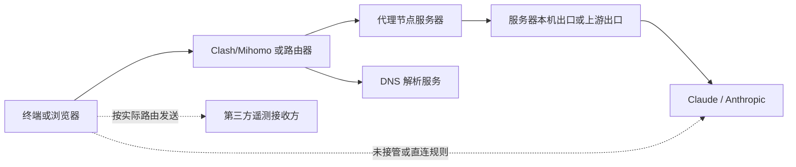

# Claude 访问来源与订阅代理隐私核查

核查日期：2026-11-15（Asia/Shanghai）。

问题：使用 SuperXray-gui 生成的订阅连接 Claude 时，Anthropic 能否通过遥测或网络信息知道终端位于中国？

用户已确认使用 Clash／Mihomo，包括路由器代理场景；Claude 的具体访问入口尚未确认。一般结论以 Anthropic 隐私政策为依据，Claude Code 部分仅作单独补充，不能用于断言 Claude 网页或移动应用必然使用相同遥测 SDK、端点或开关。

审计基线：本地 `main` 提交 `f532657137ef11ababbbe966685e5d2fbb8bbf90`。范围包括订阅生成、Clash/Mihomo 规则与 DNS、服务端 Xray 出口、源 IP 处理与日志，以及 Anthropic 官方资料。未登录用户账号，未读取真实 `.env`、数据库、订阅凭证、客户端运行配置、浏览记录或用户流量。

证据分为三层：**源码证明项目生成什么；官方政策和文档说明产品公开的数据类别及机制；实际设备与网络验证才能证明某次连接走了哪里。** 本次完成前两层和订阅生成单元测试，没有完成用户现场流量验证。

## 本地审计结论

**可能被推断地区，当前项目不能保证地区匿名；没有发现本项目主动向 Claude 上报终端原始 IP 或“中国来源”的实现，也没有证据证明 Claude 已经获取这台终端的中国公网 IP。**

当相关连接完整经过代理时，Claude 通常看到最终出口 IP。若访问 Claude 的某条连接绕过代理，接收方就可能看到终端所在网络的公网 IP。即使网络都经过代理，设备、浏览器、权限、账号和会话内容仍可能提供地区线索，订阅不会自动消除这些信息。它们可以支持推断，不能单独证明物理位置、国籍或真实住址。

### 1. 网络路径与观察者



| 观察者 | 可能看到的内容 | 不能据此推出的结论 |
| --- | --- | --- |
| Claude / Anthropic | 到达它的连接源 IP，以及应用层提供的账号、设备、请求内容等 | 看到境外出口不证明终端在境外；看到语言或时区也不证明终端在中国。 |
| 第三方遥测接收方 | 到达其服务的连接 IP 和发送给它的事件载荷 | 第三方看到 IP，不等于 Anthropic 自动获得该第三方所有日志；需有回传、共享或关联证据。 |
| 订阅服务器、代理节点、前置 CDN/反代 | 对应连接的上一跳 IP；终端直接连接时，通常是终端家庭、运营商或路由器公网地址 | 节点运营者能看到来源，不等于会把来源交给 Claude。 |
| DNS 解析服务及网络观察者 | 按实际 DNS 路径可见的查询、源地址或流量信息 | DNS 直连不等于 Claude 已收到真实终端 IP；权威 DNS 通常看到递归解析器，ECS 等机制另行分析。 |

节点与订阅服务器并不天然获得应用内部明文。普通 HTTPS 隧道中的 Claude 会话仍由终端与目标建立 TLS；本次未发现项目解密这层 TLS 后插入终端 IP 的实现。用户自行配置的 TLS 检查代理或其他上游中间件不在本次已验证范围内。

### 2. Clash/Mihomo：已确认的生成行为

下表定位于上述基线提交；默认值不代表用户数据库或客户端当前值。

| 检查项 | 源码证据 | 对地区暴露的影响 |
| --- | --- | --- |
| 默认模板 | [`web/service/setting.go:71–86`](../web/service/setting.go#L71)：路由默认开启，自定义规则空，完整 Clash 模板默认关闭 | 默认精简模板主要给出节点、代理组和 `MATCH,PROXY`；DNS、接管方式等依赖客户端已有配置。 |
| 系统接管 | [`sub/subClashService.go:27`](../sub/subClashService.go#L27)：输出不包含 TUN、`auto-route`、`dns-hijack`、全局 IPv6 或断线阻断设置 | 导入订阅本身不能证明全机或路由器 LAN 的 TCP、UDP、IPv6 已接管。未接管流量可能直连，也可能失败，取决于运行环境。 |
| 代理组选择 | [`sub/subClashService.go:151`](../sub/subClashService.go#L151)：`PROXY` 为 `select`，节点之后附加 `DIRECT` | 用户或客户端保留的选择可以令它直连；这不是源码配置了“节点故障自动回退直连”。 |
| 精简模板规则 | [`sub/subClashService.go:185`](../sub/subClashService.go#L185)：保留自定义规则顺序，必要时补最终 `MATCH,PROXY` | 前置 `MATCH,DIRECT` 可以先命中。对应行为有 [`subscription_output_matrix_test.go:363`](../sub/subscription_output_matrix_test.go#L363) 回归覆盖。 |
| 完整模板规则 | [`sub/subClashService.go:209–240`](../sub/subClashService.go#L209)：用户例外优先，其后节点、LAN、DNS、STUN 及规则集 | 完整模板过滤用户 `MATCH`，仍保留其他 `DIRECT` 例外；不能只看最后一条 PROXY。 |
| 完整模板 DNS | [`sub/subClashService.go:300`](../sub/subClashService.go#L300)：fake-ip、`respect-rules`；普通解析使用 Cloudflare DoH；bootstrap、节点及直连域名涉及阿里等解析路径，私网使用 system | 不是“所有 DNS 都走境外代理”。国内解析服务可能看到相应查询来源；这与 Claude 直接看到终端 IP 是两回事。代码未设置 ECS/client subnet，不保证客户端或外部解析器没有其他行为。 |
| 外部规则更新 | [`sub/subClashService.go:14、318、328`](../sub/subClashService.go#L318)：使用 `ryuu-restart/agent-route` 的可变 `release` 分支，每 86400 秒更新，经 PROXY 下载 | 仓库版本没有固定客户端实际加载的规则版本；需核对缓存、下载结果和前置规则。未列入某规则集不等于必然直连。 |
| UDP 与 STUN | [`sub/subClashService.go:226、338、404、488`](../sub/subClashService.go#L226)：完整模板将三个常见 STUN 端口送 PROXY，并配置 QUIC 嗅探；节点 UDP 能力按协议生成 | 端口规则、嗅探和 `udp: true` 都不能证明路由器或应用真的接管 UDP。HTTP 节点不提供 UDP；部分路径可能失败而非泄漏。 |
| 订阅诊断 | [`sub/subscription_diagnostic.go:138`](../sub/subscription_diagnostic.go#L138)：检查声明能力并提示 WebRTC/STUN 风险 | 该诊断没有执行真实 IP、DNS 或 WebRTC 泄漏探测，不能当作现场合格证明。 |

**WebRTC 的条件边界：**网页实际发起 ICE/STUN，相关流量绕过隧道并获得候选地址，且页面读取/上传或接收方记录，才形成对应暴露路径。仅有浏览器支持 WebRTC 不证明发生暴露；本次没有证据表明 Claude 当前通过 WebRTC 探测用户真实 IP。三个 STUN 端口也不是所有应用和服务器的完整覆盖清单。

**指纹边界：**节点 URI 中的 `fp=chrome`、Reality 和代理传输 TLS 参数控制的是代理传输相应链路，不会自动修改浏览器到 Claude 的内层 TLS、JavaScript 可见时区、语言或设备属性。

### 3. 当前外部规则的定点核验

2026-11-15 13:26–13:31（Asia/Shanghai）核对了远程 `release`，固定提交为 `38e8139832cfeba54642cfc2cff425b88d159c8a`，提交时间 `2026-11-15T02:03:43Z`。当时 `proxy.yaml`、`direct.yaml` 与该提交版本一致；另检查同提交的 private、reject、cn-ip 规则。

以下结果要求：启用完整模板、规则成功加载、没有更早的自定义例外，且 `PROXY` 选中实际远端节点。顺序是 `sr-private → sr-reject → sr-proxy → sr-direct → sr-cn-ip → MATCH,PROXY`。

| 域名 | 固定版本证据 | 规则结果 |
| --- | --- | --- |
| `claude.ai`、`claude.com`、`claudeusercontent.com` 及其子域 | [proxy.yaml:6376](https://github.com/ryuu-restart/agent-route/blob/38e8139832cfeba54642cfc2cff425b88d159c8a/mihomo/proxy.yaml#L6376)、6378、6387 的域名后缀规则 | PROXY |
| `anthropic.com`、`api.anthropic.com` | [proxy.yaml:2564](https://github.com/ryuu-restart/agent-route/blob/38e8139832cfeba54642cfc2cff425b88d159c8a/mihomo/proxy.yaml#L2564)：`+.anthropic.com` | PROXY；更早 reject 命中的特定子域除外。 |
| `http-intake.logs.us5.datadoghq.com` | [proxy.yaml:270](https://github.com/ryuu-restart/agent-route/blob/38e8139832cfeba54642cfc2cff425b88d159c8a/mihomo/proxy.yaml#L270)：精确域名 | PROXY |
| `browser-intake-us5-datadoghq.com`（当前 Code 文档所列） | private/reject/proxy/direct 中均无精确、父域后缀或通配命中 | 继续判断 `sr-cn-ip`：目标 IP 命中则 DIRECT，否则最终 PROXY；需实测解析与运行路由。 |
| `browser-intake-datadoghq.com` 及其子域 | [reject.yaml:24443](https://github.com/ryuu-restart/agent-route/blob/38e8139832cfeba54642cfc2cff425b88d159c8a/mihomo/reject.yaml#L24443) | REJECT；注意它不是当前 Claude Code 文档列出的 `browser-intake-us5-datadoghq.com`。 |
| `statsig.anthropic.com` | [reject.yaml:165243](https://github.com/ryuu-restart/agent-route/blob/38e8139832cfeba54642cfc2cff425b88d159c8a/mihomo/reject.yaml#L165243) | REJECT 优先；存在此条目不证明当前 Claude 会请求它。 |

上述域名已检查精确及父域后缀匹配，private/direct 没有更早命中。`browser-intake-us5-datadoghq.com` 不是 `browser-intake-datadoghq.com` 的子域，不能把相似名称当成同一规则。未知域名仍需按完整顺序判断：可能命中其他拒绝或直连规则、CN IP 规则，也可能最终 PROXY。**这是远程快照，不是用户路由器已加载内容或所有 Claude 产品端点的穷举。**

### 4. 服务端出口：不要把 server direct 当成终端直连

- [`web/service/config.json:28、58`](../web/service/config.json#L28) 默认使用服务器 `freedom/direct` 出网，另有 blocked 和基础路由，没有默认 AI 住宅出口。这里的 direct 是**代理服务器向目标直连**，目标看到服务器出口，而非因此看到终端中国 IP。实际配置由 [`web/service/xray.go:128`](../web/service/xray.go#L128) 读取保存的模板，可能不同于默认文件。
- [`frontend/src/utils/xrayCompat.ts:353`](../frontend/src/utils/xrayCompat.ts#L353) 的 AI Routing 需显式应用。没有识别到住宅出站时保留原模板；识别依赖 SOCKS 协议及 tag 含 `residential`（1029 行），不会验证真实国家或网络类型。相关 Claude 域名列于 182 行；匹配 TCP 使用住宅 balancer，UDP 指向 blocked，无 `fallbackTag`，也不改 DNS。已有 `blocked` 仅按 tag 复用，不能不看其实际协议就认定一定 blackhole。
- 保存与运行生效不同：[`web/service/xray_setting.go:21`](../web/service/xray_setting.go#L21) 做预检保存，前端另有重启操作。需要核对实际运行核心和配置，不能仅据 UI 显示判断。
- [`frontend/src/utils/gatewayEgressMvp.ts:241`](../frontend/src/utils/gatewayEgressMvp.ts#L241) 的新出口是 freedom 占位，`expectedCountryCode` 为元数据，CSV 健康值为 `manual-check`（194 行）。`US`、`residential` 或 `anthropic-egress` 名称不是实际美国住宅出口证据。
- 已经进入隧道的第三方遥测若没有命中服务端 AI 分流，可能走另一个服务器出口；这可能造成出口国家或网络类型不一致，**不能据此认定终端公网 IP 被暴露**。

### 5. 源 IP、请求头与项目自身日志

[`util/trustedproxy/trustedproxy.go:131`](../util/trustedproxy/trustedproxy.go#L131) 处理进入 Gin 的 `X-Forwarded-For`/`X-Real-IP`，用于请求来源识别等；默认信任 loopback。入站 UI 的 `acceptProxyProtocol`/`trustedXForwardedFor` 是外层代理协议配置（[`InboundsView.vue:4310`](../frontend/src/views/InboundsView.vue#L4310)），不是给 Claude HTTPS 请求添加原 IP 的代码。实际数据面由 [`xray/process.go:333`](../xray/process.go#L333) 启动的外部核心承担。

面板请求日志会记录 client IP（[`web/middleware/request_log.go:46、74`](../web/middleware/request_log.go#L46)）；订阅服务禁用了 Gin 默认输出，未安装该面板日志中间件（[`sub/sub.go:61`](../sub/sub.go#L61)），因此不能宣称默认记录每次订阅访问。前置反代/CDN 仍有自己的日志设置。

默认 Xray access 日志为 none、DNS 日志关闭（[`web/service/config.json:2`](../web/service/config.json#L2)）。在访问日志或 IP 限制等条件满足时，[`web/job/check_client_ip_job.go:66、198、387`](../web/job/check_client_ip_job.go#L66) 可以提取并保存客户端 IP。可选 Telegram IP 通知位于 [`web/service/tgbot.go:3391`](../web/service/tgbot.go#L3391)，默认关闭；另有默认关闭、URI 为空的流量 webhook，载荷 [`xray/client_traffic.go:5`](../xray/client_traffic.go#L5) 不含源 IP。

这些说明项目运营者在特定条件下能处理来源信息，不能等同于“上报给 Claude”。本次业务源码审查没有发现向 Anthropic 主动报告终端地区的路径；这不代表项目完全没有第三方外发，也不是对外部核心和任意自定义配置的绝对保证。

### 6. 现场验证顺序与判断标准

用户使用 Clash/Mihomo（含路由器），建议按以下顺序核验。分享材料时去掉订阅 URL、UUID、密码、私钥、Cookie 和账号标识；本次没有提取这些材料。

1. **确认实际生效配置。** 核对客户端/内核版本、Rule/Global/Direct 模式、PROXY 当前选项、覆写/合并规则、是否只导入节点、外部 provider 的实际缓存版本。合格条件是相关请求命中预期规则且选中远端节点，而不是仅存在名为 PROXY 的组。
2. **确认流量接管。** 桌面分别检查浏览器、应用和后台进程；路由器分别检查各 LAN/VLAN、IPv4/IPv6、TCP/UDP、策略绕过和其他网关。系统 HTTP 代理只覆盖遵循它的程序；TUN/透明代理也需要验证实际路由和防火墙。合格条件是目标流量进入预期代理路径，未覆盖协议按预期阻断或处理。
3. **观察一次真实使用。** 在 Mihomo Connections/日志中按实际目标域名、进程和规则核对 Claude 主请求及附加请求，并结合终端或路由器 WAN 抓包检查对应目的地。注意 LAN 的私有 source IP 是路由器正常可见信息，不等于被 Claude 收到。对可关联请求检查出口是否一致；一次显式代理 `curl` 只能证明该命令的路径。
4. **分别测 DNS、IPv6、UDP/QUIC。** DNS 检查解析器与分流目的；IPv6 检查是否存在未接管的默认路由；UDP 检查节点能力、路由器转发和失败行为。普通 IP/DNS 测试站只能提供部分证据，不证明所有 Claude 请求的出口；测试站本身也会看到测试连接信息。
5. **验证中断行为。** 在可恢复的测试窗口观察停止节点或代理后的相关连接，是失败、切换其他节点还是直连。合格条件取决于既定隐私策略；要求防直连时，必须实际验证连接失败而没有绕行。不能从订阅中的 select 类型推导结果。
6. **核对应用层信息。** 检查浏览器/应用位置权限、账号已有信息、隐私设置和实际使用入口。时区、语言只是线索；不要把改动它们当作匿名保证。若使用 Claude Code，再核对下文专属的代理、`NO_PROXY`、遥测和 OTel 设置；网页用户不能套用 CLI 环境变量。

完成上述验证后，可以对指定版本、配置、协议和测试窗口给出“未观察到直连”的有限结论；仍不能证明平台无法通过账号或内容推断地区，也不能永久保证将来规则或客户端更新后的行为。

### 7. 项目可评估的改进与本次验证

如后续需要加固，优先评估：为隐私用途提供明确的代理组直连选项控制；对前置 DIRECT/终止规则提示实际影响；清楚标注精简模板、完整模板和操作系统流量接管的边界；显示实际 provider 版本与更新时间；将 DNS/UDP 能力诊断与真实网络验证区分。任何策略改动都应保留普通分流需求并补充关键路径测试，不能仅靠新增几条 Claude 域名就声称防泄漏。本次只做分析，未实施这些行为变更。

已运行现有测试：

```powershell
go test ./sub -run '^(TestSubClashBuildRules.*|TestSubClashFullTemplateRules.*|TestClashFullTemplateDNSAndRuleProviders|TestClashConfig.*|TestSubscriptionNodeUDPCapability|TestJSONLocalInboundsBindLoopback|TestGenWireguardConfigIncludesPeerAndServerKeys)$' -count=1 -v
```

结果：11 项顶层测试、5 项子测试通过，无跳过。覆盖规则优先级、精简/完整订阅、DNS、UDP 声明、JSON 本地监听和 WireGuard 输出。**这是配置生成测试，不是用户设备泄漏测试。** 本次仅新增本报告，没有修改业务代码、客户端配置、数据库或部署，也没有再次发布版本。

其他订阅格式的边界：JSON 默认本地 mixed/HTTP 入站和进入核心后的默认 proxy 不等于系统全流量接管（[`sub/default.json`](../sub/default.json)、[`sub/subJsonService.go:72`](../sub/subJsonService.go#L72)）；URI/Base64 主要传递节点参数，额外路由由客户端决定；原生 WireGuard 输出双栈默认 AllowedIPs 和 DNS，但仍依赖客户端安装路由及中断处理，Clash WireGuard 节点本身不自动启用 TUN（[`sub/wireguard_subscription.go:139、217`](../sub/wireguard_subscription.go#L139)）。

## 官方资料附录

以下核对 Anthropic 隐私政策和 Claude Code 官方文档。它们描述核查日公开政策与产品说明，不是已安装客户端版本的运行验证；用户的主要场景仍以本地审计中的 Clash/Mihomo 路径为准。

## 官方资料支持的结论

不能承诺“使用代理订阅后，Anthropic 无法知道或推测终端在中国”。Anthropic 的公开隐私政策列出了 IP 地址及由 IP 推导的位置、时区、设备和浏览器信息、连接信息、移动运营商或 ISP、标识符及设备位置，并列出账号、付款、输入内容等其他信息来源。[S1]

同时，也不能据此断言“Claude 一定能穿过代理获取中国真实公网 IP”。官方网络文档明确表示，组织 IP 白名单按连接到达 Anthropic 时的来源地址检查。[S3] 在请求确实经过代理的前提下，服务端看到的网络来源通常是代理出口；这是一项网络路径推论，不是对本次用户设备实际路由的观测。其他请求是否直连、客户端是否提供位置线索，必须分别验证。

“IP 被定位到中国”“终端物理位置在中国”“用户具有中国国籍”“知道用户真实住址”是不同结论。公开政策证明 Anthropic 可以接收相关数据类别，不能证明某次会话采集了全部字段，也没有公开其如何组合这些字段判定地区、采用哪些风控阈值或判定准确率。[S1]

## 1. 隐私政策：网络、设备、账号与位置

核查时官方页面显示生效日期为 **2026-09-10**。[S1]

| 数据类别 | 官方公开内容 | 对本问题的含义与限制 |
| --- | --- | --- |
| IP 与位置 | `IP address`，包括从 IP 推导的设备位置 | IP 可以形成地理位置线索；代理出口定位不能单独证明终端实际物理位置。 |
| 设备与连接 | 设备类型、操作系统、浏览器、网页来源、移动网络、连接信息、移动运营商或 ISP、时区、标识符、设备位置 | 代理改变网络路径，不会自动改变应用层发送的设备和账号数据。政策不是各客户端逐字段的采集清单。 |
| 权限与精确位置 | 自动接收技术信息以设备或浏览器权限为条件；法律依据表以精确设备位置作为同意处理的例子 | 不应把精确定位写成绕过权限、无条件读取 GPS。拒绝精确位置权限，也不等于阻止基于 IP 的位置推断。 |
| 账号与付款 | 注册时的姓名、电子邮箱、电话号码及购买服务时的付款信息 | 这些属于另一个信息来源；本报告未核实用户账号提供了什么资料。 |
| 内容与使用日志 | 输入、输出、访问时间、使用信息、错误和日志信息 | 用户提供的内容本身可能包含位置线索。关闭可选遥测，不等于服务不再处理会话内容或必要日志。 |

简短原文证据：[S1]

> “Consistent with your device or browser permissions”

> “IP address (including information about the location of the device derived from your IP address)”

> “Consent (for example for precise device location or for health app integrations)”

适用边界：该隐私政策覆盖其网站、Claude.ai 和其他服务，同时声明，不适用于 Anthropic 代表企业客户处理的内容；企业内容处理受对应客户协议约束。不能将个人版条款直接等同于所有 Enterprise 或第三方云平台安排。[S1]

## 2. 补充：仅适用于 Claude Code 的三个数据通道

### 2.1 模型请求与服务运行

官方文档写明 Claude Code 在本地运行，但与模型交互需要联网发送数据，其中包括用户提示和模型输出，传输使用 TLS 1.2+。[S2]

> “To interact with the LLM, Claude Code sends data over the network.”

因此，“关闭遥测”“关闭模型训练使用”“经过代理”“企业零数据保留”不是同一个控制项。它们分别影响某些数据的可选发送、用途、网络路径或保留方式，不会自动使必要模型请求消失。[S1][S2][S5]

### 2.2 Anthropic 的运营遥测与错误报告

当前官方数据使用页区分两类运营遥测：[S2]

| 类别 | 文档说明 | 公开开关 |
| --- | --- | --- |
| 使用指标 | 延迟、可靠性、使用模式；发往 Anthropic 和第三方日志基础设施；文档声明不含代码、提示词或文件路径 | `DISABLE_TELEMETRY=1` |
| 错误报告 | Claude Code 自身内部错误消息与堆栈；发送前脱敏已知密钥模式、文件路径、邮箱等 | `DISABLE_ERROR_REPORTING=1` |
| 非必要流量合集 | 关闭多类非必要流量，包括以上指标与错误报告 | `CLAUDE_CODE_DISABLE_NONESSENTIAL_TRAFFIC=1` |

简短原文证据：[S2]

> “Claude Code sends two kinds of operational telemetry: usage metrics and error reports.”

> “Metrics never include your code, prompts, or file paths.”

错误报告不是所有账号和版本一概默认开启。当前文档写明，需要同时满足 Pro／Max／Ultra 登录、v2.1.198 或更新版本、直接连接 Claude API，且组织没有 ZDR 或 HIPAA 协议等条件。[S2] 网络页另外提到服务端发布开关，因此不能仅靠环境变量未设置就断定某台机器实际发出了错误报告。[S3]

当前官方网络表列出的运营遥测相关端点包括：[S3]

- `api.anthropic.com`：模型请求、WebFetch 域名安全检查、功能开关获取和遥测事件日志等。
- `http-intake.logs.us5.datadoghq.com`：可选运营遥测事件。
- `browser-intake-us5-datadoghq.com`：可选运营错误报告。

本次读取的当前 `data-usage` 与 `network-config` 页面**没有将 Sentry／Statsig 列作当前端点**。不能依据旧文章、记忆或历史版本，把它们写成核查日所有 Claude Code 安装的事实；也不能从当前列表反向证明旧客户端从未使用过这些服务。

开关范围有明确限制：[S2]

- `DISABLE_TELEMETRY` 或 `CLAUDE_CODE_DISABLE_NONESSENTIAL_TRAFFIC` 也会关闭功能开关评估，可能影响 Remote Control；`DISABLE_ERROR_REPORTING` 不会。
- WebFetch 的域名安全检查不受 `CLAUDE_CODE_DISABLE_NONESSENTIAL_TRAFFIC` 控制；文档为其声明了独立设置 `skipWebFetchPreflight`。
- 官方插件市场自动安装也有独立控制项。不能把“非必要流量”变量理解成“只剩一个模型请求端点”。
- `/feedback`、`/bug`、`/share` 的用户主动反馈可能提交会话内容，另有 `DISABLE_FEEDBACK_COMMAND` 控制。运营指标“不含提示词”的承诺不能推广到反馈通道。

上述变量针对 Claude Code。未发现官方证据表明，在终端设置这些变量会同时关闭浏览器 Claude 网页或普通移动／桌面聊天界面的遥测。[S2][S3]

### 2.3 用户或组织自行配置的 OpenTelemetry

官方监控文档明确：向自有后端导出 OpenTelemetry 是主动启用功能，需要显式配置；其与 Anthropic 运营遥测独立。[S4]

> “OpenTelemetry export to your backend is opt-in and requires explicit configuration.”

启用后，可包含账号 UUID、邮箱、会话 ID、终端类型、操作系统和架构等属性；数据发送到配置的 OTel 接收端。官方特别说明该通道中的邮箱发往所配置的 OTel 端点，而不是 Anthropic。不能把此处的字段表直接当作 Anthropic 默认运营遥测字段表。[S4]

默认不采集用户提示正文，相关正文、工具参数、工具内容、原始 API 请求和响应体分别受 `OTEL_LOG_*` 配置控制。启用详细采集后可能包含文件内容、路径、命令或会话内容。需要检查实际配置和接收端，不能只根据是否设置 `DISABLE_TELEMETRY` 判断组织是否另行配置了 OTel。[S4]

## 3. 补充：Claude Code 的代理支持与网络边界

官方网络文档列出了 `HTTPS_PROXY`、`HTTP_PROXY` 和 `NO_PROXY`，也接受小写变量。选择顺序为 `https_proxy`、`HTTPS_PROXY`、`http_proxy`、`HTTP_PROXY`。`NO_PROXY` 可以令特定目标或全部请求绕过代理。[S3]

简短原文证据：[S3]

> “Claude Code does not support SOCKS proxies.”

这意味着，不能仅因为代理客户端开放了 SOCKS5 端口，就认定把该端口填入 Claude Code 代理变量是受支持的接法。是否使用本地 HTTP／mixed 入口、系统路由或其他方式，应由实际客户端配置和运行验证决定。

官方文档还指出：[S3]

- 桌面应用管理提供商连接的部分会话，只从托管设置和用户级 `~/.claude/settings.json` 读取代理配置，避免仓库设置重定向连接；不同会话类型的作用域有区别。
- 后台任务的 supervisor 共享进程可能继承首次启动它的 shell 环境，后来仅修改另一个 shell 的变量不保证覆盖该后台会话。
- 独立 CLI 的端点列表不覆盖网页／桌面所有请求；网页和桌面还加载额外 Anthropic CDN、内容和组件域名。
- 组织 IP 白名单按请求到达时的地址判断；不同目标域名可以因为代理策略而使用不同出口。

本次官方页面没有提供“设置上述代理变量即可保证全机 DNS、IPv6、UDP／QUIC、浏览器 WebRTC、第三方工具和子进程全部使用同一出口”的承诺。此类保证不能从“支持 HTTP 代理”推导出来。DNS 查询路径与 Anthropic 实际接收的连接来源也应分别检查；仅看到本地 DNS 活动，不足以证明 Anthropic 已收到终端原始公网 IP。

## 4. 按产品入口区分，避免把 CLI 结论外推

| 入口 | 官方可确认的依据 | 仍需本地或产品专项验证的内容 |
| --- | --- | --- |
| Claude 网页 | 隐私政策列设备、浏览器、连接、IP 和位置等类别；网络文档列网页附加域名 [S1][S3] | 浏览器代理、权限、扩展、各请求实际出口；不能使用 CLI 遥测变量代替网页设置。 |
| Claude 移动应用 | 通用隐私政策列移动网络、运营商、设备位置，并限定设备权限 [S1] | 具体应用版本、位置权限、系统 VPN／代理覆盖范围。不能断言本次已读取 GPS 或 SIM 信息。 |
| Claude Desktop | 通用隐私政策，以及网络文档中的桌面附加域名与部分 Code 会话配置作用域 [S1][S3] | 普通聊天、Code tab、本地／云端／Cowork 会话的区别；不能假定一组 shell 变量覆盖整个应用。 |
| 本地 Claude Code | 模型请求、运营遥测、OTel、HTTP 代理及不支持 SOCKS 的专门文档 [S2][S3][S4] | 已装版本、实际生效变量／设置、认证入口、代理分流、MCP／工具流量。 |
| 云端 Claude Code | 默认在 Anthropic 管理的 VM 执行，另有自托管环境；云端执行有自己的网络与会话数据流 [S2] | 本地打开页面的连接与云端执行连接不是同一条路径，不能用云端出口证明本地设备出口。 |

## 5. 遥测关闭与必要日志的限制

关闭可选遥测，可以减少相应额外数据流，但不能据此宣称 Anthropic 不再看到请求来源 IP、账号认证信息、模型输入，或不再保留任何服务、安全和用量记录。[S1][S2]

作为范围区别的例子，官方 ZDR 文档说明，它主要覆盖合资格组织下的模型推理输入／输出；Claude Code Analytics 的账号邮箱和使用统计、用户席位管理数据等不在同一覆盖范围内。即便 ZDR，也存在依法或处理使用政策违规所需的数据保留例外。[S5] 这不是说普通用户必须启用 ZDR，而是说明“训练用途”“内容保留”“运营遥测”“网络来源可见性”不能互相替代。

本报告没有证据支持以下断言：Anthropic 通过某种未公开方式固定读取真实中国 IP；一定通过中文输入、时区或设备指纹判定中国；存在已知可保证通过地区风控的配置；关闭遥测即可保证匿名。对于这些问题，当前公开资料不足以验证。

## 官方来源与复核方式

所有链接于 2026-11-15 通过只读 HTTP GET 成功获取；Claude Code 使用官方 Markdown 版本便于核对原文。未使用二手文章作为事实依据。

- **[S1] Anthropic Privacy Policy**（页面生效日期：2026-09-10）：<https://www.anthropic.com/legal/privacy>。重点：Collection of Personal Data、Uses of Personal Data、Legal Bases for Processing。
- **[S2] Claude Code — Data usage**：<https://code.claude.com/docs/en/data-usage.md>。重点：Local Claude Code、Telemetry services、Default behaviors by API provider、WebFetch domain safety check。
- **[S3] Claude Code — Enterprise network configuration**：<https://code.claude.com/docs/en/network-config.md>。重点：Proxy configuration、Network access requirements、Organization IP allowlists and proxy egress、Desktop and claude.ai。
- **[S4] Claude Code — Monitoring usage**：<https://code.claude.com/docs/en/monitoring-usage.md>。重点：Standard attributes、Service information、Security and privacy。
- **[S5] Claude Code — Zero data retention**：<https://code.claude.com/docs/en/zero-data-retention.md>。重点：What ZDR covers、What ZDR does not cover、Data retention for policy violations。

复核时先确认页面版本和已安装客户端版本，再检查用户选择的入口与真实网络配置。文档可能变化，源码默认配置也不代表某台设备已实际导入并生效；没有运行证据时应保留这一限制。
